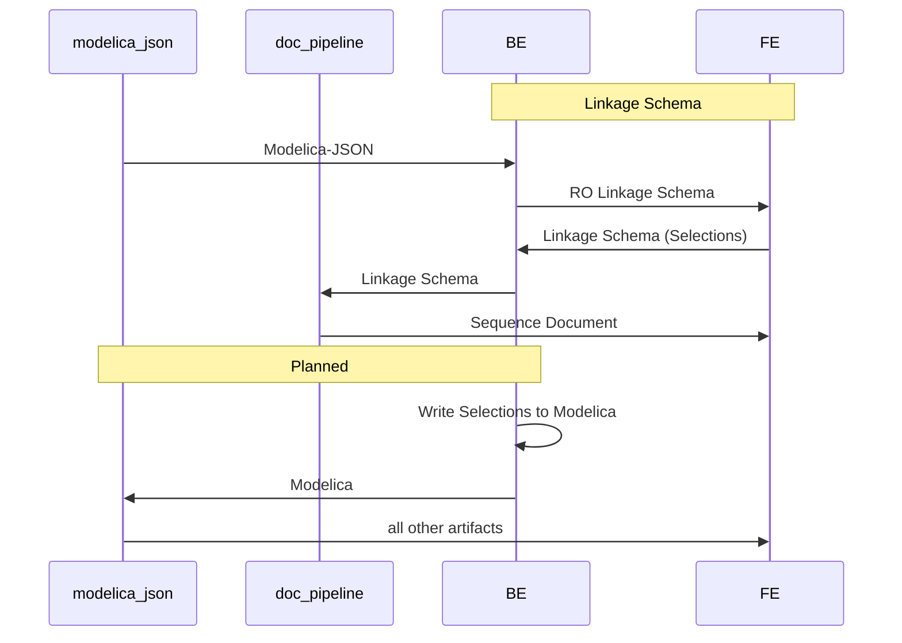

# Linkage Schema

Linkage Schema is the intermediate format extracted by the parser from modelica-json to narrowly capture what is necessary to:

1. Render available input from a template
2. Record input to for use to generate a completed modelica template

## Overview of Data Types

Read-Only Data types (static data extracted from modelica packages)

- `SystemType`: template category
- `Template`: Modelica Template
- `Option`: a node of info from the template that either specifies how to render a dropdown or bit of UI, or links to a list of child `Option`s
- `ScheduleOption`: a `Table` object representing the column headers and cells of a schedule table derived from a Modelica record class

Write Data types (data created from user input):

- `Project`: User project that contains configs
- `ProjectDetail`: project meta-data
- `Config`: Container for a configuration that includes the template and the list of component selections
- `Selection`: Each selection made/input in a template
- `FullConfig`: A configuration that is fully configured with component configuration (from the config page) and mechanical and control points specified (from the schedule page)

## Overview of Data-Flow:



## Modelica Path

The parser extracts portions of a template and uses `modelicaPath`s as a unique identifier for that portion of a template. This is leveraging modelica's path system that uses dot access to indicate where to find a given piece of modelica.

For example, this is the path to a MultizoneVAV template:

`Buildings.Templates.AirHandlersFans.MultizoneVAV`

And a path to a parameter within the MutlizoneVAV template:

`Buildings.Templates.AirHandlersFans.MultizoneVAV.supBlo`

Most of the linkage schema data types use this path (using the keyname `modelicaPath`) as a unique identifier.

## Read-only Types

`templates.json` holds the templates, the system types and the options, and the versions of the libraries they are generated from (`libraries`, e.g. `{ "Buildings": "14.0.0" }`: the `version` annotation of the root package). The versions are reported in the payload (`meta.libraries`). The templates and the system types follow the order of the library ([template-order.md](template-order.md)).

### SystemTypes

System types are categories for templates.

```typescript
export interface SystemTypeInterface {
  description: string; // user facing string
  modelicaPath: string;
}
```

### Templates

Holds meta info about a given template. Templates have a one to many relationship with SystemTypes.

`modelicaPath`: the UUID for the template, as well as the identifier for the entrypoint option in the options table.

`systemTypes`: this is an in-order hierarchical list of categories. Currently modelica-buildings only has categories one level deep, but we need to support multiple levels.

`pathModifiers`: Templates have implementations of components that contain `outer` declarations, with the template implementing the `inner` portion. This ends up as a map, mapping from the `outer` path segment to the `inner` path segment.

```typescript
export interface TemplateInterface {
  modelicaPath: string;
  pathModifiers: { [key: string]: string };
  scheduleOptionPaths: string[];
  systemTypes: string[];
  name: string; // Class Description
}
```

For example, `VAVBoxReheat` has the following modifiers:

```json
"pathModifiers": {
  "ctl.damVAV": "damVAV",
  "ctl.coiHea": "coiHea",
  "ctl.datAll": "datAll"
},
```

In an evaluation engine, all path segments that reference `ctl.damVAV` get replaced with `damVAV` when using the `VAVBoxReheat` template.

### Options

An option represents a 'node' of info from the template that _could_ be rendered into visible UI in the front-end.

```
`visible`: if 'true' this option can be rendered depending on the value of 'enable'
`type`: a modelica path to a specific type OR a primitive type ('String', 'Number', 'Boolean')
`value`: the 'value' of an option. What value means depends on the template node (is it a replaceable, a definition, a primitive?)
`enable`: An expression to determine whether or not an option is enabled.
`modifiers`: instance data that can overwrite the values present in an `Option`.
`options`: available selections for a given option OR
`choiceModifiers`: some instance data is only applied if a specific choice is made. Those modifiers are included grouped by the 'choice' path (which )
`constrainingModifiers`: for a replaceable element with a constraining clause, the modifiers of that clause. When the element is redeclared, they replace `modifiers` (MLS 7.3.2). Absent if there is no constraining clause.
`kindOfClass`: for a class definition, its class prefixes without `partial` (e.g. "model", "expandable connector"), as repeated in a redeclaration. Absent for components and enumeration literals.
```

The keys of `modifiers`, `constrainingModifiers` and of each entry of `choiceModifiers` are the paths of the modified elements relative to the option, as written in Modelica (MLS 7.2): `typVal` in the modifiers of the component `Buildings.Templates.ZoneEquipment.Interfaces.VAVBox.coiHea`, `coiHea.typVal` in the modifiers of the class `Buildings.Templates.ZoneEquipment.Interfaces.VAVBox`. A key never repeats the path of its option, and the modification of the option itself is its `value`, not a modifier. The interpreter appends the key to the instance path of the option (#656).

A choice whose modification is written nested, as `val(typ=…)` in `choice(redeclare Coil coiHea(val(typ=…)))`, is rejected by the parser (#416). The `final` modifications of the elements of a component redeclared `final` in a choice are kept, e.g. `replaceable_param.component_param` for `choice(redeclare FourthComponent selectable_component(redeclare final SecondComponent replaceable_param))`.

```typescript
export interface OptionInterface {
  modelicaPath: string;
  type: string;
  name: string;
  value?: string | boolean | null | number | expression;
  group?: string;
  tab?: string;
  visible?: boolean;
  options?: string[];
  enable?: Expression;
  modifiers: { [relativePath: string]: { expression?: Expression | Literal; final: boolean } };
  choiceModifiers?: { [key: string]: Modifiers };
  constrainingModifiers?: Modifiers;
  definition: boolean;
  kindOfClass?: string;
  replaceable: boolean;
}
```

Options have a recursive structure with each `Option` potentially having child `options`.

This one-to-many relationship creates the tree representing the nodes that make up a template.

See [ui-design-choices.md](./ui-design-choices.md) for how the front-end interprets `group`/`tab` to build the configuration panel's display order and layout.

### Expressions

```typescript
export type Literal = boolean | string | number;

export type Expression = {
  operator: "<>" | "!=" | "!" | "||" | "&&" | "if" | "else" | "if_elseif" | "else_if" | "for" | "if_array" | "primary_array" | "function_call" | string;
  operands: Array<Literal | Expression>;
};
```

`Operator`: a string indicating which operation.
`Operands`: a list that can either be a literal value (like the number `4`) or another expression to resolve.

Literal values (booleans, numbers, and fully-resolved strings) are stored directly as `Literal`, not wrapped in an `Expression`.

String `Literal`s come in two flavours:
- **Variable reference** — a valid Modelica identifier such as `"ctl.typCtlFanRet"`. The interpreter looks this up in the current scope to obtain its value.
- **String literal** — a Modelica string constant stored with its surrounding quotes escaped, e.g. `"\"foo\""` (JSON encoding of `"foo"`). The interpreter JSON-parses the value to recover the plain string `foo`, distinguishing it from a variable reference.

### Schedule Table

Scheduled parameters are extracted from Modelica record classes specified for each template using the class annotation `__ctrlFlow(schedule={"modelica://..."})`.

The schedule parser transforms these records into a structured `Table` object that represents both the header structure (columns) and data cells.

`LeafColumn` — a concrete parameter column:

```typescript
interface LeafColumn {
  kind: "leaf";
  instanceName: string;     // relative instance name, e.g. "ctl.k"
  label: string;            // display label, e.g. "Air flow rate"
  type: string;
  value?: number | string | boolean | Expression; // default binding
  final?: boolean;          // true if locked by a final modifier
  unit?: string;
  displayUnit?: string;
  min?: number | Expression;
  max?: number | Expression;
  start?: number | Expression;
  enable?: boolean | Expression;
}
```

`GroupColumn` — a named column group, nestable arbitrarily deep:
- Created from `Dialog(group=...)` or `Dialog(tab=...)` annotations
- Created for record-typed component instances (children are the record's parameters)

```typescript
interface GroupColumn {
  kind: "group";
  label: string;            // e.g. "Cooling coil"
  instanceName?: string;    // relative instance name, present only for record instances
  type?: string;
  children: Column[];       // nested LeafColumn or GroupColumn entries
  enable?: boolean | Expression;
}
```

```typescript
type Column = LeafColumn | GroupColumn;
```

`Cell` — a single data value for a given row and column:

```typescript
interface Cell {
  rowIndex: number;
  columnInstanceName: string; // matches a LeafColumn instanceName
  value: string | number | boolean | null;
}
```

`Table` — the complete schedule table:

```typescript
interface Table {
  configuration: string;    // effective type path of the 'cfg' component
  columns: Column[];        // tree of headers
  cells: Cell[];            // data cells, filled at UI runtime
}
```

From this example table:

```
                                   |              group1               |
                 |    subgroup1    |    subgroup2    |     subgroup3   |
  Row   |--------|-----------------|--------|--------|-----------------|
  index | param1 | param2 | param3 | param4 | param5 | param6 | param7 |
|-------|--------|--------|--------|--------|--------|--------|--------|
| 1     |  val1  |  val2  |  val3  | val4   | val5   | val6   |  val7  |
| 2     |  ...
```

- `param1` is a `LeafColumn` at the top level (`columns` array directly).
- `param2` and `param3` are `LeafColumn` entries nested inside a `GroupColumn` with `label: "subgroup1"`.
- `param4` and `param5` are `LeafColumn` entries nested inside a `GroupColumn` with `label: "subgroup2"`, which is itself nested inside a `GroupColumn` with `label: "group1"`.
- Each 'val' cell is a `Cell` whose `columnInstanceName` matches the corresponding `LeafColumn`'s `instanceName`.

## Write Data - User Configurations

### Project

`Project` contains metadata about a project

```typescript
export interface ProjectDetailInterface {
  name: string;
  address: string;
  type: string;
  size: number;
  units: string;
  code: string;
  notes: string;
}

export interface ProjectInterface {
  id: string;
  projectDetails: ProjectDetailInterface;
}
```

### Configurations

Configurations hold all input for a given template.

```typescript
export interface Config {
  [key: string]: string | number | undefined | boolean | SelectionInterface[];
  id: string;
  name?: string; // user facing string
  isLocked?: boolean; // TODO: likely remove
  selections?: SelectionInterface[];
  quantity?: number;
  systemPath: string; // TODO: remove this - info already available in template
  templatePath: string; // modelica path for a given template
}
```

### Selections

```typescript
export interface Selection {
  path: string;
  value: any;
}
```

When a user makes a selection related to a component in `ctrl-flow`, (e.g., when selecting 'Fan array'for a component of the Multi-zone ) the following key-value pair is created:

```json
{
  "Buildings.Templates.AirHandlersFans.VAVMultiZone-secOutRel.secOut": {
    "redeclare": "Buildings.Templates.AirHandlersFans.Components.OutdoorSection.DedicatedDampersPressure"
  }
}
```

The 'key' is composed of two parts, the template and the path of the element in the template. The value is an object: the class of a replaceable component is a redeclaration (`redeclare`), and the value of a parameter is a `value`.

```
rootClass: Buildings.Templates.AirHandlersFans.VAVMultiZone
elementPath: secOutRel.secOut

redeclare: "Buildings.Templates.AirHandlersFans.Components.OutdoorSection.DedicatedDampersPressure"
```

The key identifies the element across all templates. See [selection-keys.md](selection-keys.md) for the grammar, the resolution rules and the attributes of the values.
